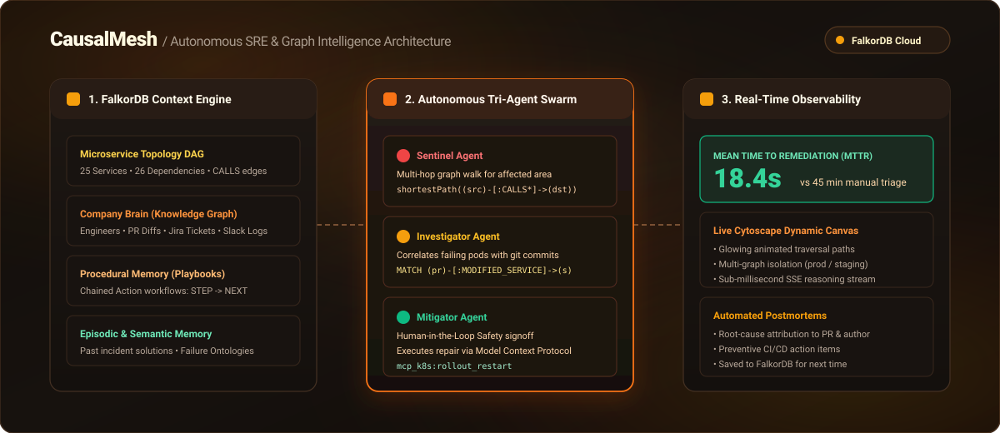
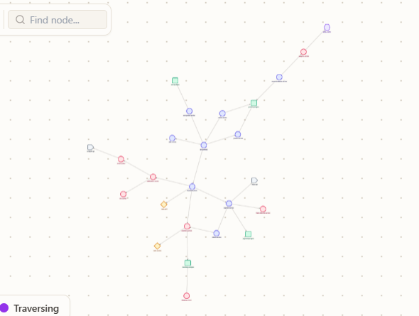
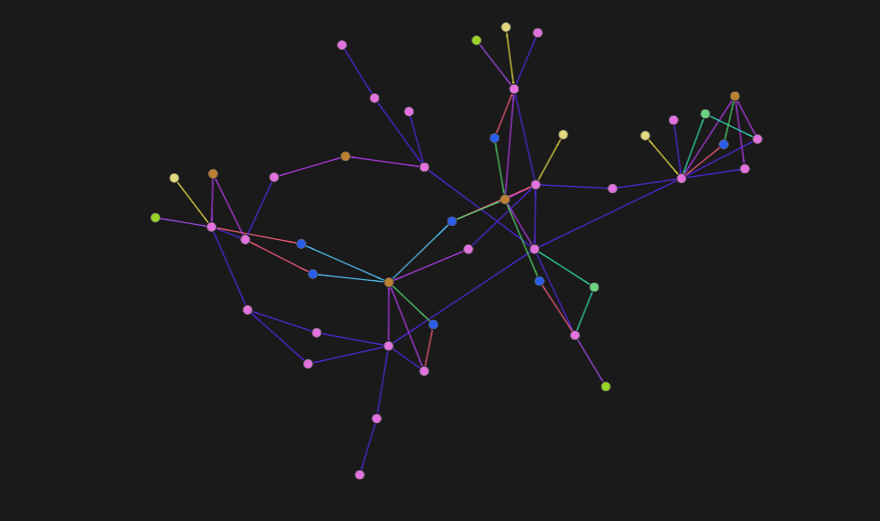

# CausalMesh
### Autonomous Site Reliability & Incident Memory Mesh Powered by FalkorDB

[](https://www.falkordb.com/)
[](LICENSE)
[](https://fastapi.tiangolo.com)
[](https://nextjs.org)
[](https://github.com/yashvirsingh09/CausalMesh)

<p align="center">
  
</p>

> *"The graph has to shape what the agent does, not sit on the side."*  
> **CausalMesh** unifies live microservice topologies, git pull requests, team ownership, and executable procedural playbooks into a single high-performance **FalkorDB** graph.

**[Watch Demo Video (YouTube)](https://youtu.be/skAD7R8OXp8)** • **[Live Deployment & Setup Guide](DEPLOYMENT.md)** • **[Demo Video Script & Guide](DEMO_VIDEO_GUIDE.md)** • **[Technical Architecture Article](BLOG_POST.md)**

---

## Executive Overview

Modern cloud engineering teams run hundreds of interconnected microservices. When an alert fires at 3:00 AM, human engineers spend 45 minutes manually triaging logs, asking *"Who changed what?"* on Slack, and digging up outdated runbooks.

**CausalMesh** replaces that panic with an **Autonomous Tri-Agent Swarm** that uses **FalkorDB** as its living context layer:
- **Topology & Reach:** Ingests microservice dependency DAGs and computes cascade blast radiuses via OpenCypher traversals.
- **Company Brain:** Connects Git commits, Pull Requests, author attributions, and Slack on-call rosters directly to service nodes.
- **Procedural & Episodic Memory:** Stores executable remediation playbooks as graph workflows and persists incident episodes in FalkorDB so future agents never resolve the same problem twice.

---

## Live Visuals & FalkorDB Cloud Graph

| Live Microservice Topology DAG (Dynamic Traversal) | FalkorDB Cloud Multi-Dimensional Knowledge Graph |
| :---: | :---: |
|  |  |
| *Real-time 25-node microservice topology with glowing multi-hop incident traversal* | *Live AWS FalkorDB Cloud instance connecting Services, PRs, Engineers, and Action Workflows* |

---

## Core Capabilities & Architectural Pillars

| Architectural Pillar | Core Capability | CausalMesh Implementation |
| :--- | :--- | :--- |
| **Connected Graph Intelligence** | Multi-hop reasoning, graph queries as tools, tool selection through MCP, explainable results. | • Sentinel Agent runs multi-hop Cypher queries across 25 services in $< 2\text{ms}$.<br>• Native graph algorithms as agent tools: **shortestPath** and **bottleneck centrality**.<br>• Mitigator Agent calls infrastructure tools via **Model Context Protocol (MCP)**.<br>• Full visual Cytoscape.js path animation showing exact Cypher lineage. |
| **Procedural & Episodic Memory** | Persistent history, executable workflows, shared state handoffs, multigraph isolation. | • **Procedural Memory:** Stored executable playbooks (`(:Procedure)-[:STEP]->(:Action)-[:NEXT]->(:Action)`).<br>• **Episodic Memory:** Past incident episodes queryable via symptom matching & MTTR tracking.<br>• **Semantic Memory:** Domain failure ontology & risk rules (`(:SemanticRule)`).<br>• **Multi-Agent Handoffs:** Persistent graph handoff states (`(:AgentHandoff)`).<br>• **Multigraph Isolation:** Completely isolated `prod` vs `staging` graphs in a single FalkorDB instance. |
| **Enterprise Knowledge Graph** | Docs, tickets, and team chats in one graph; engineer expertise discovery; decision traceability. | • Enterprise showcase query: **"Who Knows What"** engineer expertise directory.<br>• Connected graph of **Jira Tickets**, **Slack Chats**, **Git PRs**, and **Runbooks**.<br>• Instant provenance tracing linking system failures back to human merge decisions and chat channels. |

---

## FalkorDB Data Model

```cypher
// 1. Topology & Algorithms
CREATE (gw:Service {name: 'api-gateway', tier: 'api', status: 'healthy'})
CREATE (checkout:Service {name: 'checkout-service', tier: 'api', status: 'failing'})
CREATE (inv:Service {name: 'inventory-service', tier: 'worker', status: 'degraded'})
CREATE (db:Service {name: 'inventory-postgres', tier: 'database', status: 'failing'})
CREATE (gw)-[:CALLS]->(checkout)
CREATE (checkout)-[:CALLS {latency_p99_ms: 45}]->(inv)
CREATE (inv)-[:CALLS {protocol: 'tcp'}]->(db)

// 2. Enterprise Knowledge Graph (Company Brain)
CREATE (dave:Engineer {name: 'Dave Kim', slack: '@dave', role: 'Backend Dev'})
CREATE (alice:Engineer {name: 'Alice Mehta', slack: '@alice', role: 'Staff SRE'})
CREATE (pr88:PullRequest {id: 'PR-88', title: 'Reduce DB idle timeout to 2s', merged_at: '2026-10-11T18:00:00Z'})
CREATE (dave)-[:AUTHORED]->(pr88)
CREATE (alice)-[:APPROVED]->(pr88)
CREATE (pr88)-[:MODIFIED_SERVICE]->(inv)
CREATE (t:Ticket {id: 'TICK-1042', title: 'Memory pressure on inventory workers', priority: 'P2'})-[:ATTACHED_TO]->(pr88)
CREATE (m:SlackMessage {channel: '#deployments', text: 'Merged PR-88 tuning idle timeout'})-[:REFERENCES]->(inv)
CREATE (d:Doc {title: 'DB Pool Starvation Runbook', url: 'https://wiki.internal/runbooks/db-pool'})-[:DOCUMENTS]->(db)

// 3. Procedural Memory Graph
CREATE (p:Procedure {name: 'resolve_db_pool_starvation', trigger_pattern: 'db_pool_exhaustion', success_rate: 0.95})
CREATE (a1:Action {name: 'scale_db_pool', tool: 'mcp_infra:patch_config', order: 1})
CREATE (a2:Action {name: 'restart_pods', tool: 'mcp_k8s:rollout_restart', order: 2})
CREATE (a3:Action {name: 'verify_error_rate', tool: 'mcp_metrics:error_rate', order: 3})
CREATE (p)-[:STEP]->(a1)-[:NEXT]->(a2)-[:NEXT]->(a3)

// 4. Episodic Memory Episode
CREATE (ep:Episode {incident_id: 'INC-2026-10-11', alert_name: '504 Gateway Timeout', mttr_seconds: 14, status: 'resolved'})
CREATE (ep)-[:INVOLVED]->(checkout)
CREATE (ep)-[:INVOLVED]->(inv)
```

---

## Quickstart Guide

### 1. Prerequisites
- Python 3.12+
- Node.js 18+
- (Optional) Docker for local FalkorDB or use live FalkorDB Cloud

### 2. Startup (Backend + Frontend)
- **On Windows (PowerShell):**
  ```powershell
  .\run-dev.ps1
  ```
- **On Linux / macOS:**
  ```bash
  chmod +x run-dev.sh
  ./run-dev.sh
  ```

### 3. Or Run Manually

#### Backend:
```bash
cd backend
python -m venv venv
venv\Scripts\activate   # Windows (or: source venv/bin/activate on Linux/Mac)
pip install -r requirements.txt

# Run all 37 unit and integration tests (37/37 passing in ~31s)
python -m pytest -v

# Start FastAPI server on http://localhost:8000
python main.py
```

#### Frontend:
```bash
cd frontend
npm install
npm run dev
```

Open `http://localhost:3001` in your browser.

---

## Live Video Demonstration

[](https://youtu.be/skAD7R8OXp8)

> **[Click here to watch the full CausalMesh demonstration on YouTube](https://youtu.be/skAD7R8OXp8)**

---

## 90-Second Walkthrough Routine

1. **The Baseline:** Open `http://localhost:3001`. The Cytoscape.js map displays 25 microservices in green.
2. **The Incident Fires:** Select **"504 Gateway Timeout on /checkout"** and click **Simulate Incident**.
3. **Watch the Coordinating Agents:**
   - `checkout-service` and its dependencies glow **RED / ORANGE**.
   - **Sentinel Agent** evaluates the affected area via FalkorDB graph walk and finds the shortest path.
   - **Investigator Agent** inspects recent PRs, attributing root cause to **PR #88** (Dave Kim / Alice Mehta).
   - **Mitigator Agent** retrieves Procedural Memory for `resolve_db_pool_starvation`, pauses for Human Approval, and executes verified MCP actions.
4. **Autonomous Resolution:**
   - All topology nodes turn **EMERALD GREEN**.
   - MTTR clock completes in **~18 seconds** (vs 45-minute industry average).
   - An auto-generated Markdown Postmortem appears with full attribution and preventive action items.
   - FalkorDB persists the new Episode node into memory for next time.

---

## License
Apache-2.0 © 2026 CausalMesh Contributors.
